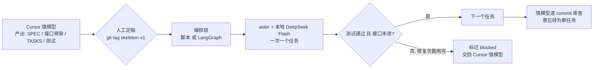

# 分级模型编码工作流：调研汇总与交接文档

> **生成时间**：2026-10-04 15:42 (GMT+8)
> **用途**：汇总本轮调研（aider 源码解析 + 17 个仓库审阅）的结论、可复用资源与建议方案，供新工作区继续实施。
> **工作流名称**：`skeleton-relay`（骨架接力），新工作区以此命名。
> **编排层方案对比**：见同目录 `skeleton-relay-orchestrator-options-2026-10-04.md`（结论：先做脚本版，满足条件后迁移 LangGraph）。
> **执行层候选**：aider（首选）与 DeepSeek Harness / dsh（本地 `D:\database\agent\dsh\deepseek-harness`，保留待 A/B 评估），见上述对比文档 §7。
> **前置文档（同目录）**：
> - `model-tier-planner-executor-research-2026-10-02.md`：开源方案初筛（Web/GitHub 检索）
> - `aider-architect-editor-code-analysis-2026-10-04.md`：aider Architect/Editor 源码级解析
> - `aider-architect-blog.zh.html`：aider 官方架构博客中文版

---

## 1. 目标工作流

1. **规划阶段（Cursor 强模型）**：Claude Opus 5.5 / Grok 4.6 / DeepSeek V4.1 Flash 与用户讨论需求，产出完整代码骨架（接口、签名、桩函数、规格文档、任务清单、测试）。
2. **定稿**：人工审核骨架，打 git tag 冻结。
3. **实现阶段（本地 DeepSeek V4 Flash，OpenAI 兼容接口）**：基于骨架逐任务实现。
4. **审查阶段（可选）**：强模型逐 commit 审查；失败任务升级回强模型。

核心诉求：**阶段式**——骨架完整定稿并持久化后才开始编码；规划不在执行工具内完成，而在 Cursor 中完成。

---

## 2. 总结论

- 17 个已克隆仓库中，**没有一个能开箱覆盖完整流程**。
- 由于规划在 Cursor 完成，各项目自带的 planner 价值不大；真正要选的是三层：
  - **执行层**：弱模型能否稳定改代码 → **aider**（首选）/ gptme（备选）
  - **编排层**：阶段门禁、逐任务、测试失败升级 → **自写脚本**（轻量）或 **LangGraph**（完整）
  - **交接物格式**：骨架和任务清单的结构 → 参考 **MetaGPT** 文档流水线 + **agent-workflow-mcp** 的 Plan schema
- 所有仓库都**没有**"失败自动升级回强模型"，这一环必须自写。

---

## 3. aider 评估要点（执行层首选）

仓库：`aider/`，commit `5dc9490`，版本 0.86.3.dev。

### 3.1 Architect 模式本身不适合阶段式流程

| 问题 | 证据 |
|---|---|
| 规划与编码在同一轮内连续执行，方案是对话文本，不落盘 | `aider/coders/architect_coder.py` `reply_completed()`：`content = self.partial_response_content` → `editor_coder.run(with_message=content)` |
| 无任务拆分，整份方案一次发给 editor | 同上 |
| 测试/lint 失败只在 editor 内修复，最多 3 次，不升级 | `base_coder.py` L101 `max_reflections = 3`，L939-941 |
| `--read` 只读文件不是硬锁，`--yes-always` 下可被编辑 | `base_coder.py` L2191 `allowed_to_edit()`，L2227 "Allow edits to file that has not been added to the chat?" |
| 无 review 角色 | — |
| Architect 提示词针对增量修改（"DO NOT show the entire updated function/file"），不适合生成骨架 | `architect_prompts.py` |

### 3.2 值得复用的部分（作为执行器）

- 普通 code 模式 + 本地模型：`--openai-api-base` + `--model openai/<name>`
- 编辑格式配置：`.aider.model.settings.yml`（弱模型 diff 格式遵循差时用 `whole`）；上下文长度写在 `.aider.model.metadata.json`
- 任务输入：`--message-file`；接口/规格只读挂载：`--read`
- 反馈循环：`--test-cmd` + `--auto-test`，`--lint-cmd`（`base_coder.py` L1599-1623）
- git 自动提交：每任务一个 commit，便于审查与回滚
- 脚本化：Python API `Coder.create(...).run(...)`，见 `aider/website/docs/scripting.md`
- `--map-tokens` 可按本地模型上下文调小

---

## 4. 其余仓库审阅结果

目录均在 `D:\database\agent\dsh-workspace\learn\model-tier-workflow-search\`。

| 仓库目录 | 契合度 | 定位 | 一句话 |
|---|---|---|---|
| `langchain-ai-langgraph` | 4 | 编排层首选 | `interrupt` / `interrupt_after` + checkpointer 精确实现阶段门禁；无编码工具，需自接 |
| `FoundationAgents-MetaGPT` | 4（参考） | 交接格式参考 | 文档流水线落盘为 JSON；但按角色配模型未接线、`--implement/--run-tests` 失效 |
| `crewAIInc-crewAI` | 4 | 编排层备选 | Flows `@persist` / `@human_feedback` / `from_pending` + per-agent LLM；无 diff/测试闭环 |
| `gptme-gptme` | 3 | 执行层备选 | subagent `mode="planner"/"executor"` + `model=` 覆盖 + `provider=local`；无阶段门禁 |
| `YSMsimon-Warden` | 4（参考） | 端到端参考 | `PLANNER_MODEL`/`EVALUATOR_MODEL` 分离 + 写文件工具 + 3 轮评估修复；计划不落盘，已停更 |
| `tainguyen07-agent-workflow-mcp` | 3.5（参考） | Plan schema 参考 | 类型化 `Plan/Step/stop_when` + SQLite 事件日志 + 角色分模型配置；仅 Anthropic，执行端只读 |
| `musistudio-claude-code-router` | 4（可选组件） | 执行期网关 | 让 Claude Code / Codex / OpenCode 等走本地 DeepSeek；规则/脚本路由；v3.1.1 活跃 |
| `microsoft-autogen` | 3 | 不建议 | 已进入维护模式；`MagenticOne` 便捷类所有 agent 共用一个 client |
| `AleBrito124356-nim-agent-lab` | 3 | 教学参考 | replanner 鲁棒性写法（解析失败保留原计划）；单一 client |
| `liu-shiqiang-CellAgent` | 3 | 领域原型 | 单细胞分析 Planner/Executor/Evaluator；单一 LLM，计划不落盘 |
| `Zio-94-HieraPlan` | 3 | 计划落盘参考 | 分层计划导出 JSON/Markdown；无 executor |
| `monaccode-astromesh` | 2.5 | 过重 | 生产级 agent 运行时，声明式 workflow ≠ 阶段式骨架 |
| `lm-sys-RouteLLM` | 2 | 不相关 | 单请求强弱分流；2024-08 后停更 |
| `vllm-project-semantic-router` | 2 | 不相关 | 生产级 MoM 请求路由，基建重 |
| `aurelio-labs-semantic-router` | 1 | 不相关 | 意图语义路由库 |
| `alphaparkinc-genpark-hierarchical-task-network-htn-planner-skill` | 2 | 不相关 | 无 LLM 的经典 HTN 算法 demo |
| `alphaparkinc-genpark-agent-hierarchical-planner-skill` | 1 | 不相关 | 空壳 stub |

### 4.1 已核实的关键事实

- **MetaGPT `roles:` 配置未生效**：`config2.py` L96 定义 `roles: Optional[List[RoleCustomConfig]]`，全仓无读取 `config.roles` 的代码；可用替代是 `Config.from_llm_config(...)` 手动构造 Role，或 Action 级 `llm_name_or_type`。
- **MetaGPT 旧流水线被注释**：`software_company.py` L56-62 `Engineer` / `QaEngineer` 招募被注释；默认 `TeamLeader + Engineer2`（RoleZero 动态编排）。
- **Warden**：`common/config.py` L38-39 `EVALUATOR_MODEL` / `PLANNER_MODEL` 缺省回落到主 `MODEL`；无独立 `EXECUTOR_MODEL`。
- **gptme #2361**：本地 changelog 无此编号，语义对应 #2364（architect/editor 拆分，`docs/releases/v0.32.0.md:302`），当前代码树中无对应 CLI 实现。
- 无任何仓库实现"失败自动升级回强模型"。

---

## 5. 可复用资源清单（语料 / 代码 / 提示词）

### 5.1 提示词

| 资源 | 路径 | 用途 |
|---|---|---|
| MetaGPT WriteCode 提示词 | `FoundationAgents-MetaGPT/metagpt/actions/write_code.py` L34-84 | 弱模型实现单文件的提示词模板："Only One file"、"YOU MUST FOLLOW 'Data structures and interfaces'"；上下文结构 Design / Task / Legacy Code |
| MetaGPT WriteDesign | `FoundationAgents-MetaGPT/metagpt/actions/design_api.py` | 系统设计 JSON 结构（含 Data structures and interfaces、Program call flow） |
| MetaGPT WriteTasks | `FoundationAgents-MetaGPT/metagpt/actions/project_management.py` | 任务清单 JSON 结构（文件列表、依赖顺序） |
| MetaGPT WriteCodeReview | `FoundationAgents-MetaGPT/metagpt/actions/write_code_review.py` | 多轮 LGTM/LBTM 审查提示词 |
| aider Architect 提示词 | `aider/aider/coders/architect_prompts.py` | "editor 将完全依赖你的指令，所以要明确完整" |
| aider Editor 提示词 | `aider/aider/coders/editor_whole_prompts.py` 等 | 只改代码、不做推理 |
| nim-agent-lab 三角色提示词 | `AleBrito124356-nim-agent-lab/src/patterns/planner_executor.py` L143-170 | planner / executor / replanner 提示词 |

### 5.2 数据结构 / 设计片段

| 资源 | 路径 | 用途 |
|---|---|---|
| Plan / Step schema | `tainguyen07-agent-workflow-mcp/src/agent_workflow_mcp/models.py` L69-92 | `Step{index, intent, tool_calls, stop_when}`、`Plan{goal, steps, rationale}`，`stop_when` 即验收条件 |
| 角色分模型配置 | `tainguyen07-agent-workflow-mcp/config/default.yaml` L8-13 | `planner_model` / `executor_model` / `critic_model` |
| MetaGPT 产物目录约定 | `FoundationAgents-MetaGPT/metagpt/const.py` L90-94 | `docs/prd`、`docs/system_design`、`docs/task`、`docs/code_plan_and_change` |
| Warden 评估修复环 | `YSMsimon-Warden/agent/loop.py` L118-144 | 最多 3 轮 Evaluator → 针对 issues 再派 executor |
| Warden OpenAI 兼容适配 | `YSMsimon-Warden/adapters/openai_compat_adapter.py` | DeepSeek / Ollama / 自定义 base_url |
| HieraPlan 分层计划导出 | `Zio-94-HieraPlan/app/core/models.py`、`app/main.py` L40-48 | PlanNode → JSON/Markdown 落盘 |

### 5.3 编排能力

| 资源 | 路径 | 用途 |
|---|---|---|
| LangGraph `interrupt()` | `langchain-ai-langgraph/libs/langgraph/langgraph/types.py` L893+ | 节点内暂停等待人工确认 |
| LangGraph `compile(interrupt_after=...)` | `langchain-ai-langgraph/libs/langgraph/langgraph/graph/state.py` L1177+ | 设计节点后强制暂停 |
| LangGraph plan-and-execute 示例 | `langchain-ai-langgraph/examples/plan-and-execute/` | 模式参考（部分已迁到文档站） |
| CrewAI `@human_feedback` | `crewAIInc-crewAI/lib/crewai/src/crewai/flow/human_feedback.py` | Flow 中审批分支 |
| CrewAI `from_pending` / `resume` | `crewAIInc-crewAI/lib/crewai/src/crewai/flow/runtime/__init__.py` L1252+ | 暂停后恢复 |
| gptme subagent | `gptme-gptme/gptme/tools/subagent/api.py` L163+、L464+ | `mode` + `model=` 覆盖 |
| CCR 路由规则 | `musistudio-claude-code-router/packages/core/src/gateway/claude-code-router-plugin.ts` L94-121、L355-416 | 自定义 router 脚本、按模型档位改写 |

---

## 6. 建议组合方案

### 6.1 交接物（Cursor 阶段产出）

参考 MetaGPT 文档流水线，至少包括：

- **骨架代码**：完整签名、类型标注、docstring，函数体为 `raise NotImplementedError` / TODO
- **`SPEC.md`**：需求、约束、设计决策、数据结构与接口说明、调用流程
- **`TASKS.md`**（或 `tasks.json`）：按依赖排序，每个任务包含：
  - `id`、`title`、`depends_on`
  - `files`：允许修改的文件
  - `read_only`：需要参考的接口/规格文件
  - `instructions`：实现要点
  - `acceptance`：验收条件，指向具体测试用例（类似 agent-workflow-mcp 的 `stop_when`）
- **测试**：由强模型先写好，作为弱模型必须满足的契约

### 6.2 编排层两种选择

| 选项 | 适用 | 规模 |
|---|---|---|
| Python 脚本 | 任务数不多、人工盯着跑 | 约 200 行：读 TASKS → 逐任务调 aider → 跑测试 → 检查接口 diff → 标记状态 |
| LangGraph | 需要断点续跑、自动升级、审查节点 | 约 300-700 行：`design → interrupt → implement → test → (retry / escalate) → review` |

### 6.3 必须自写的环节

1. **任务循环**：每个任务只 add `files`，`--read` 挂载 `read_only`，`--message-file` 传入任务描述。
2. **接口保护**：每个任务完成后检查 `git diff skeleton-v1 -- <接口文件>` 为空（或比对函数签名），否则回滚该 commit。不要依赖 `--read`。
3. **失败升级**：aider 反思次数用完或测试仍失败 → 任务标记 `blocked`，打包 diff + 报错 + 任务描述交回强模型。
4. **审查**：按 commit 取 diff 交给强模型审查，审查意见写回 TASKS 作为新任务。

### 6.4 本地模型配置要点

- 接入：`--openai-api-base http://<host>:<port>/v1 --model openai/<model-name>`
- `.aider.model.settings.yml`：设置 `edit_format`（diff 不稳定时改 `whole`，并控制单文件大小）
- `.aider.model.metadata.json`：填写真实上下文长度与输出上限
- 视上下文大小调小 `--map-tokens`

---

## 7. 下一步（新工作区）

- [x] 确定编排层形态：先做 Python 脚本版，按 LangGraph 结构编写以便迁移（详见 `skeleton-relay-orchestrator-options-2026-10-04.md`）
- [ ] 定义 `TASKS.md` / `tasks.json` 的格式（参考 6.1）
- [ ] 准备 Cursor 侧规划提示词 / Rule：要求按 6.1 格式产出骨架与任务清单（可改写 MetaGPT WriteDesign / WriteTasks 提示词）
- [ ] 配置本地 DeepSeek Flash 的 aider 接入，并用一个小任务验证编辑格式遵循度
- [ ] 实现编排脚本最小版本：任务循环 + 测试 + 接口保护 + blocked 标记
- [ ] 增加审查环节与失败升级
- [ ] 用一个小项目端到端试跑，记录弱模型失败类型，迭代提示词与任务粒度
