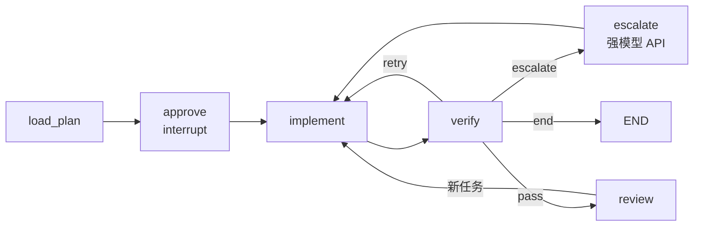

# skeleton-relay 编排层方案对比：Python 脚本 vs LangGraph

> **生成时间**：2026-10-04 16:08 (GMT+8)
> **工作流名称**：`skeleton-relay`（骨架接力）——强模型在 Cursor 中产出并定稿代码骨架，交棒给本地模型逐任务实现，再回到强模型审查。
> **关联文档（同目录）**：`model-tier-workflow-handoff-2026-10-04.md`（调研汇总与交接）

---

## 0. 结论

- **先做脚本版**，用于验证本地 DeepSeek Flash 能否稳定按骨架填实现、确定任务粒度与提示词。
- 脚本版按 LangGraph 的结构编写（状态即 State、函数即节点），以便后续平滑迁移。
- 满足升级条件（见 §5）后再迁移到 **LangGraph 版**。

---

## 1. 共同点

两个版本做的核心事情相同：

1. 读取 Cursor 阶段产出的骨架、`SPEC.md`、`TASKS.md`、测试；
2. 按依赖顺序逐任务调用 aider（本地 DeepSeek Flash，OpenAI 兼容接口）；
3. 每个任务完成后跑测试、检查接口是否被改动；
4. 失败任务交回强模型处理；
5. 实现完成后进入审查。

本质区别在于：**流程控制和状态保存由谁负责。**

- **脚本版**：普通 `for` 循环；状态靠 `TASKS.md` 字段 + git commit；暂停、审批、升级靠人工。
- **LangGraph 版**：流程是一张状态图，节点之间按条件跳转；框架在每个节点后自动持久化状态，可原地暂停等待审批、崩溃后从断点恢复、自动把失败任务交给强模型。

---

## 2. 脚本版

### 2.1 结构示意

```python
tasks = load_tasks("TASKS.md")            # 解析 id / files / read_only / acceptance / status
for task in topo_sort(tasks):
    if task.status in ("done", "blocked"):
        continue                           # 重跑时自动跳过 → 天然断点续跑
    run_aider(task)                        # aider --model openai/deepseek-flash --file ... --read ... --message-file ...
    if not interface_unchanged("skeleton-v1", task.read_only):
        git_reset_last_commit(); mark(task, "blocked", "改动了接口")
        continue
    ok, log = run_tests(task.acceptance)
    mark(task, "done" if ok else "blocked", log)
write_report()                             # 汇总 blocked 任务的 diff + 报错，交给用户拿去 Cursor
```

### 2.2 各能力的实现方式

| 能力 | 实现方式 |
|---|---|
| 状态持久化 | `TASKS.md` 中每个任务的 `status` 字段 + 每任务一个 git commit |
| 断点续跑 | 重新运行时跳过 `done` / `blocked` 任务（任务粒度） |
| 测试失败修复 | aider 自带 `--auto-test` 反思循环（最多 3 次） |
| 接口保护 | `git diff skeleton-v1 -- <接口文件>` 非空则回滚该 commit |
| 交回强模型 | 标记 `blocked` + 生成报告 → 用户在 Cursor 处理 → 改回 `todo` 重跑 |
| 审查 | 跑完后在 Cursor 中逐 commit 审 diff |
| 依赖 | Python 标准库 + aider + git |
| 调试 | 打印 / 断点，代码一眼可读 |

### 2.3 优缺点

- **优点**：约 200 行；零新增依赖；易调试；最快拿到"弱模型能否胜任"的结论。
- **缺点**：升级与审查全靠人工；断点粒度是任务级；并行需自写；流程分支一多代码会变乱。

---

## 3. LangGraph 版

### 3.1 结构示意

```python
g = StateGraph(State)
g.add_node("load_plan", load_plan)        # 读骨架 + TASKS
g.add_node("approve", approve)            # interrupt()：暂停，等待确认骨架已定稿
g.add_node("implement", implement)        # 调 aider + 本地模型
g.add_node("verify", verify)              # 测试 + 接口保护
g.add_node("escalate", escalate)          # 调强模型 API 生成修复方案 / 改写任务
g.add_node("review", review)              # 强模型审 diff，必要时 interrupt() 等用户拍板
g.add_conditional_edges("verify", route, {
    "pass": "review", "retry": "implement",
    "escalate": "escalate", "next": "implement", "end": END})
g.add_edge("escalate", "implement")
app = g.compile(checkpointer=SqliteSaver.from_conn_string("run.db"))
```



### 3.2 各能力的实现方式

| 能力 | 实现方式 |
|---|---|
| 状态持久化 | checkpointer 在每个节点后把完整 State 写入 SQLite |
| 断点续跑 | 同一 `thread_id` 从断点恢复，可回放任一步（节点粒度） |
| 人工审批 | `interrupt()` 原地暂停，`Command(resume=...)` 继续；可放在定稿、升级、审查任意位置 |
| 交回强模型 | `verify` 判定失败次数用尽 → 路由到 `escalate`，强模型分析原因、改写任务或给修复，再回 `implement` |
| 审查 | 作为图中节点，审查意见自动转为新任务进入循环 |
| 并行 | 无依赖任务可原生并行 |
| 可观测性 | 可视化图结构，可接 LangSmith 追踪 |
| 依赖 | langgraph、langchain-openai、checkpointer、强模型 API key |
| 调试 | 需理解 State / reducer / 条件边 / interrupt 语义，学习成本较高 |

### 3.3 优缺点

- **优点**：自动升级与审查可无人值守；节点级断点恢复；审批点灵活；流程复杂后依然清晰。
- **缺点**：约 300–700 行；新增依赖；调试与理解成本高；**自动升级依赖强模型 API**。

---

## 4. 关键约束：强模型是否可通过 API 调用

LangGraph 版最大的价值是**自动升级**和**自动审查**，前提是编排程序能通过 API 调用强模型。

- **只用 Cursor 订阅中的强模型**（Opus 5.5 / Grok 4.6）：外部脚本无法调用，升级与审查仍需人工切到 Cursor。此时 `interrupt()` 只是"停下等人"，与脚本版标记 `blocked` 效果相当，LangGraph 的优势大幅缩水。
- **另有强模型 API**（如 DeepSeek V4.1 Flash 官方 API、Anthropic / xAI key）：LangGraph 价值完全释放，弱模型失败后可自动修复，用户只在关键节点审批。

---

## 5. 对比总表

| 维度 | 脚本版 | LangGraph 版 |
|---|---|---|
| 代码量 | 约 200 行 | 约 300–700 行 |
| 新增依赖 | 无 | langgraph、langchain、checkpointer |
| 断点续跑 | 任务级，靠状态字段 | 节点级，自动持久化，可回放 |
| 人工审批 | 改状态后重跑 | `interrupt()` 原地暂停后继续 |
| 交回强模型 | 生成报告，人工处理 | 可全自动（需 API） |
| 审查 | 事后人工 | 图中节点 |
| 并行任务 | 需自写 | 原生支持 |
| 上手 / 调试 | 很容易 | 中等偏难 |
| 适用阶段 | 验证工作流可行性 | 流程稳定后自动化 |

---

## 6. 迁移路径

### 6.1 脚本版为迁移预留的设计

- `TASKS.md` 的字段与任务状态按 LangGraph 的 State 设计：`id`、`depends_on`、`files`、`read_only`、`instructions`、`acceptance`、`status`（`todo` / `done` / `blocked`）、`attempts`、`last_error`。
- `run_aider`、`verify`、`interface_unchanged`、`write_report` 写成独立的纯函数，入参与返回值与节点函数一致；迁移时直接注册为节点。

### 6.2 升级到 LangGraph 的触发条件（满足任一即可）

1. 获得强模型 API，希望失败任务自动交给强模型、无人值守地跑完；
2. 任务多到需要并行执行，或单次运行长达数小时，需要可靠的断点续跑；
3. 希望把审查固定为流程中的一步，审查意见自动转为新任务。

---

## 7. 执行层候选：aider vs DeepSeek Harness（dsh）——保留待评估

> **状态**：保留，未定论。新工作区通过 A/B 试跑后再决定。
> **核实时间**：2026-10-04 16:47 (GMT+8)
> **核实对象**：本地仓库 `D:\database\agent\dsh\deepseek-harness`，版本 `0.2.0-rc.2`，commit `639ed01539`（2026-09-29）
> **上游**：[deepseek-ai/deepseek-harness](https://github.com/deepseek-ai/deepseek-harness)（MIT，开发者预览，官方声明会有不兼容变更）

### 7.1 已核实的能力

| 执行层需要的能力 | 结论 | 依据 |
|---|---|---|
| 被编排脚本调用 | ✅ | `packages/bundle/headless`：每次运行一个任务；完成返回 0，中止或出错返回 1；`--json` 输出按行 JSON 事件流；`--session-id` 续接持久化会话；任务可从 stdin 读入（`-`） |
| 接入本地 DeepSeek | ✅ | `docs/user/guide/providers.zh.md`：自定义提供商 `api: openai-completions` + `baseURL`，写在当前 profile 的 `cordis.patch.yml`；或设置 `DEEPSEEK_BASE_URL` |
| Windows 运行 | ✅ | 本地实测 `pnpm dsh --profile headless --help` 正常（Node v24.20.0）；SDK 文档列出 Windows x64；模型可用的命令行工具在 Windows 上为 `pwsh` |
| 接口文件拦截 | ⚠️ 部分 | `packages/hooks/hooks-claude-code`：复用 Claude Code `hooks.json`，`PreToolUse` 可 `deny` 并把原因反馈给模型；但按工具名匹配，模型经 `pwsh` 写文件可绕过；`updatedInput` 不生效 |
| 写入范围限制 | ⚠️ 目录级 | `docs/subsystems/sandbox.zh.md`：`read-only` / `workspace-write` / `danger-full-access`，不能细到单文件；Windows ACL 后端为部分强制执行 |

### 7.2 与 aider 的对比

| 维度 | aider | dsh |
|---|---|---|
| 工作方式 | 指定文件，模型输出编辑 | 模型自主探索、编辑、执行命令 |
| 对弱模型要求 | 低：输出合规 diff 即可 | 较高：多步工具调用中不跑偏 |
| 与 DeepSeek 契合 | 通用适配 | 官方出品，默认模型 `deepseek-v4-flash` |
| 测试与修复 | `--auto-test`，最多 3 次 | agent 自行跑测试、修复 |
| git 提交 | 自动 | 编排脚本负责 |
| 文件范围控制 | `--file` / `--read` 天然限定 | 提示词 + `PreToolUse` 钩子 + 事后 git diff |
| 失败升级 | 需换工具 | 同一框架换模型（本地 Flash → V4 Pro API） |
| 可观测性 | 对话日志 | `--json` 事件流记录每次工具调用 |
| 成熟度 | 稳定（0.86） | 预览版（0.2.0-rc.2） |

### 7.3 接入方式草案

```powershell
$env:DEEPSEEK_BASE_URL = "http://127.0.0.1:<port>/v1"
Get-Content task-007.prompt.md -Raw | pnpm dsh --profile headless --json - > logs\task-007.jsonl
# 退出码 0 后：跑测试 → git diff skeleton-v1 检查接口 → 编排脚本 git commit
```

- 任务提示词需写明：允许修改的文件、禁止修改接口签名、完成后运行的测试命令。
- 接口保护采用两层：`PreToolUse` 钩子事前拦截编辑器工具；编排脚本 `git diff skeleton-v1 -- <接口文件>` 作最终检查，非空即回滚。
- 编排脚本只依赖最外层契约（命令行 + 退出码 + `--json`），不深度依赖插件 API，以降低预览版变更风险。

### 7.4 A/B 评估计划

用同一个小骨架 + 3～5 个任务，分别让 aider 与 dsh 驱动本地 DeepSeek Flash，记录：

- 测试通过率（首轮 / 修复后）
- 触碰接口文件的次数
- 单任务耗时与 token 消耗
- 失败类型（格式错误、跑偏、测试不过、越界修改）

---

## 8. 新工作区 `skeleton-relay` 的第一步

- [x] 定义 `TASKS.md` 格式（字段见 6.1）：Markdown + 每任务一个 ```` ```yaml task ```` 块；模板 `templates/TASKS.md`，解析/校验/排序/回写 `orchestrator/tasks.py`，命令 `relay validate|list`
- [x] 编写 Cursor 侧规划 Rule：`.cursor/rules/skeleton-relay-planning.mdc`
- [x] Python 环境：conda 环境 `skeleton-relay`（Python 3.11），已 `pip install -e ".[dev]"`
- [x] 接口保护检查 `orchestrator/guard.py`，命令 `relay check <任务id> [项目] --base <任务开始前的提交>`：
  - 整文件冻结：`read_only` + `protected` 相对 `skeleton-v1` 不得改动
  - 越界修改：相对 `--base`，只允许 `files` 中的文件变化（`TASKS.md` 除外，含未跟踪文件）
  - 签名冻结：`files` 中的 `.py` 用 `ast` 比对 `skeleton-v1`，骨架符号（函数/类/方法/类字段，含装饰器、默认值、返回注解）不得修改或删除，不得新增公开符号；允许新增 `_` 私有符号和函数体内的嵌套定义
- [x] aider 接入本地 DeepSeek Flash 并冒烟通过（见 §9）
- [ ] dsh 接入本地 DeepSeek Flash，用同一骨架冒烟
- [ ] 按 §7.4 做执行层 A/B 评估，决定 aider 或 dsh
- [x] 脚本版核心循环 `orchestrator/runner.py`：任务循环 + 接口保护 + 验收测试 + 失败回滚重试（带上次错误）+ `blocked`
- [ ] `blocked` 报告：汇总 diff + 报错 + 任务描述，供 Cursor 强模型处理
- [ ] 用小项目端到端试跑，记录失败类型，迭代提示词与任务粒度
- [ ] 评估是否满足 §6.2 的升级条件

---

## 9. aider 冒烟测试记录（2026-10-04）

> **骨架**：`examples/calc`（四则运算计算器，3 个链式依赖任务，32 个测试；已用参考实现验证测试正确）
> **命令**：`python scripts/smoke.py --thinking off|on [--temperature 0.6]`，每次在 `sandbox/<时间>-<名称>/` 新建仓库并打 `skeleton-v1`
> **执行**：aider 0.86.2，`diff` 编辑格式，`--auto-test`，repo map 关闭
> **服务**：vLLM `http://<vllm-host>:8888/v1`（注意端口 8888；需绕过本机代理 127.0.0.1:7897），`deepseek-v4-flash-vision-exp`，上下文 1M，默认思考强度 high

| 配置 | T001 | T002 | T003 | 总耗时 | 输出 tokens | 格式错误 | 接口违规 |
|---|---|---|---|---|---|---|---|
| 思考关，temperature 0 | 首轮通过 24s | 首轮通过 23s | 首轮通过 17s | 64s | 1.6k | 0 | 0 |
| 思考开，temperature 0 | 3 次均耗尽 16k 输出 token，手动终止 | — | — | — | — | — | — |
| 思考开，temperature 0.6 | 首轮通过 132s | 首轮通过 155s | 首轮通过 62s | 349s | 15.2k | 1（aider 自行修复） | 0 |

**结论与注意事项**

- 关闭思考（`chat_template_kwargs: {thinking: false}`）即可稳定完成此粒度的任务，速度约为开思考的 5 倍，作为默认配置。
- 开思考 + temperature 0 会陷入重复退化（同一句话重复上千次直至耗尽 `max_tokens`）；开思考必须设 temperature ≈ 0.6。
- `reasoning_effort`（顶层或 `chat_template_kwargs`）在简单提示上看不出明显效果，未定论。
- 风险：模型回复中提及 `tests/...` 文件名，aider 在 `--yes-always` 下可能把它加入对话变为可编辑；本轮未发生，靠 `guard` 兜底。
- 本骨架偏简单，尚不能区分 aider 与 dsh；A/B 评估需要更难的骨架（跨文件调用、更长实现、更易越界的任务）。
